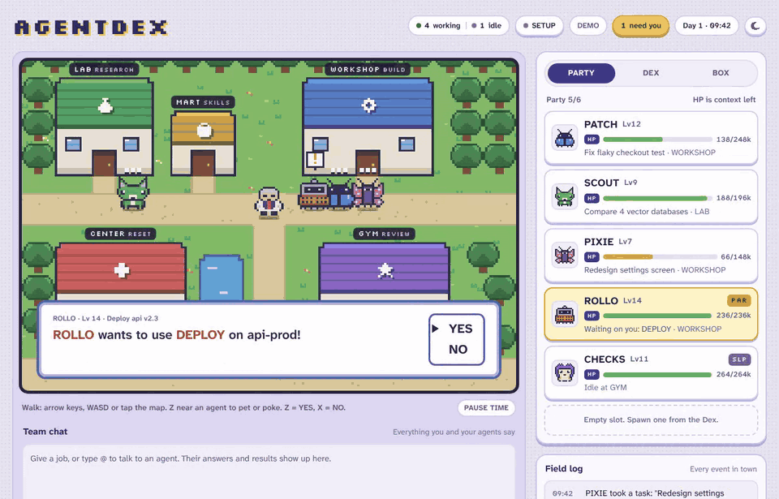

# Agentdex

[](https://github.com/ivanntongg/agentdex/actions/workflows/test.yml)

[](https://www.npmjs.com/package/agentdex-town)
[](LICENSE)


**A pixel town where your AI agents live, work, and ask before they do anything that matters.**



**[Try the demo in your browser](https://ivanntongg.github.io/agentdex/)** (pretend agents, nothing to install) · **Run it:** `npx agentdex-town`

- Your AI agents are creatures in a handheld-style town. When one **walks to a building**, it really started or handed over work.
- Before anything risky, an agent stops and asks you in a **YES / NO dialog box**. A second agent can review the work first.
- You walk around as the Professor: give agents jobs, pet them, poke them, and watch everything in the field log.
- Optional: **control it from WhatsApp** while your computer runs at home.

Real agents are powered by [Claude](https://www.anthropic.com/claude) and work only inside one folder on your computer. A free practice mode with pretend agents needs no account.

---

## Install

### The quick way: one command

Install **Node.js** (the **LTS** version from [nodejs.org](https://nodejs.org)), open a terminal (**Terminal** on a Mac, **PowerShell** on Windows) and run:

```bash
npx agentdex-town
```

Type `y` if it asks to install. The town opens in your browser and the SETUP screen helps you connect Claude ([step 4](#4-connect-claude-first-time-only) below). Keep the terminal open while you play; press **Ctrl + C** to stop.

- Your town, settings and the agents' workspace are kept in an **Agentdex** folder in your home folder (`~/Agentdex` on a Mac, `C:\Users\<you>\Agentdex` on Windows). Updates never touch it.
- Next time, run the same command. To get the newest version, run `npx agentdex-town@latest`.
- Pretend agents only, no Claude needed: `npx agentdex-town --practice`. All options: `npx agentdex-town --help`.

### The full way: download with Git

Use this if you want the desktop shortcut or to change the code. You need about 15 minutes. You will type a few commands into a **terminal**: on a Mac open the **Terminal** app, on Windows open **PowerShell** from the Start menu. Paste each command, press Enter, and wait for it to finish before the next one.

### 1. Install the two free tools

| Tool | Get it | Check it worked |
|---|---|---|
| **Node.js** (version 20 or newer) | Download the **LTS** version from [nodejs.org](https://nodejs.org) and run the installer | `node -v` shows `v20` or higher |
| **Git** | **Mac:** run `git --version` and click Install if asked. **Windows:** install from [git-scm.com](https://git-scm.com/download/win) with the default options | `git --version` shows a version |

Close and reopen the terminal after installing, so it finds them.

### 2. Download Agentdex

```bash
git clone https://github.com/ivanntongg/agentdex.git
```

```bash
cd agentdex
```

```bash
npm ci
```

### 3. Start it

```bash
npm run real
```

Open **http://localhost:8787** in your browser. Keep the terminal open while you use it; press **Ctrl + C** in the terminal to stop.

### 4. Connect Claude (first time only)

The **SETUP** screen opens by itself. Pick how your agents connect:

**Option A: API key** (pay as you go, works for everyone)

1. Sign in to the [Claude Console](https://platform.claude.com), add some credit, open **API keys** and create a key (it starts with `sk-ant-`).
2. In SETUP choose **API key**, paste it, choose how hard the agents should think (Medium is a good start) and press **SAVE & TEST**.

Your key is saved only on your computer, in `agentdex.config.json`. Treat it like a password: never share it or commit it.

**Option B: your Claude plan** (Pro or Max, through Claude Code)

1. [Install Claude Code](https://code.claude.com/docs/en/setup) on the same computer (on Windows, use the native installer).
2. Open a terminal, run `claude` and sign in with your Claude account. Close it afterwards.
3. In SETUP choose **My Claude plan** and press **SAVE & TEST**.

Agentdex starts the official Claude Code app for each task; it never sees or stores your login. Tasks count toward your plan's usage limits, which are meant for ordinary personal use, so use an API key for heavy or shared use.

When SETUP says **CONNECTED**, close it. Four agents are waiting at the CENTER.

**Just want to look around first?** Run `npm start` instead of `npm run real`. It starts practice mode with pretend agents: free, and no key needed.

### Update later

Stop Agentdex first (close its window), then in the agentdex folder:

```bash
git pull
```

```bash
npm ci
```

If `git pull` says your local changes to `package-lock.json` would be overwritten, run `git restore package-lock.json` and pull again. That file only lists package versions.

### Desktop shortcut

Agentdex comes with a launcher that starts everything and opens your browser. It finds the agentdex folder by itself, installs on first run, and if Agentdex is already running it just opens the town.

- **Windows:** open the `agentdex\launchers` folder, right-click **Agentdex.bat**, choose **Send to**, then **Desktop (create shortcut)**. Double-click the new shortcut on your Desktop. If Windows says it "protected your PC", choose **More info**, then **Run anyway**.
- **Mac:** open the `agentdex/launchers` folder in Finder and double-click **Agentdex.command**. To keep it handy, drag it to your Dock while holding **Cmd + Option**.

Close the window it opens to stop Agentdex. Because the shortcut points into the agentdex folder, it keeps working after updates.

---

## Your first task

1. In **PARTY** on the right, click **SCOUT**.
2. In **GIVE TASK**, type something small and specific, for example *Compare 3 free note-taking apps for a student and save a one-page summary to notes/apps.md*. Leave **Ask a reviewer** ticked and press **SEND**.
3. SCOUT walks to the LAB and starts working. Its **HP** drops as the job gets longer.
4. Saving outside the `drafts` folder needs your permission, so SCOUT asks: *"SCOUT wants to use WRITE on notes/apps.md!"* Press **YES** or **NO**.
5. SCOUT walks to the GYM, where **CHECKS** reviews the work. If CHECKS asks for changes, SCOUT gets one round to fix them.
6. The field log shows a one-line summary. The files are in the `workspace` folder inside `agentdex`.

| Agent | Good at |
|---|---|
| **PATCH** | Code and technical fixes |
| **SCOUT** | Research, with web search |
| **QUILL** | Writing and editing, with web search |
| **CHECKS** | Reviews other agents' work (tick "Ask a reviewer" instead of giving it tasks) |

Every real task uses a little API credit. For cheaper, quicker runs, open SETUP and choose **Low**, or pick the **Haiku** model.

## Tell your team

Under the map is the **team chat**: one conversation with everyone. Your jobs, agents' answers, finished results and YES / NO questions all show up there, and it is saved with the town. The **field log** with every event in town sits on the right, under the menu.

Below the team chat is one box for everything. Press **/** anywhere in the town to jump to it. Type **@** to pick an agent from a list, or click one of the agent buttons above the box.

| You type | What happens |
|---|---|
| `compare 3 note-taking apps` | No name: the best-suited free agent takes it (research goes to SCOUT, writing to QUILL, code to PATCH) |
| `quill write 5 video titles` | Start with a name to choose the agent |
| `@scout how is it going?` | Talk to an agent, without giving it a task |
| `status` | What everyone is doing |
| `yes` / `no` | Answers the open request |
| `reset scout` | Clears an agent that fainted or got stuck |
| `rename scout to max` | Gives an agent a new name (one word, 2 to 12 letters or numbers) |

You can also rename an agent with **RENAME** on its summary. The same commands work from WhatsApp.

### Give your agents files

Drag files anywhere onto the town, or press the paperclip in the command box or an agent's chat. Files go into `workspace/inbox`, and your next message or task tells the agent which files to use. Text files work in both modes; PDFs and images work best with **My Claude plan**, because Claude Code reads them directly. Files up to 25 MB. Needs `npm run real`.

### Agents remember their work

After every task, an agent remembers what it did, its summary and the files it made (its last 20 tasks). It uses that memory in later tasks and chats, so "update the comparison you did yesterday" works. You can see it under **Remembers** on the agent's summary. Memory is saved with the town.

## Talk to your agents

Open an agent's summary and use **Talk to SCOUT**, or type `@scout` followed by your message anywhere commands work, including WhatsApp. Talking is not working:

- The agent answers in its own voice, knows what it is doing and what it finished recently, and can **read** files in the workspace to answer you. It cannot change anything in a chat.
- If you ask for work, it says how it would do it and offers **DO IT AS A TASK**. Nothing starts until you press it.
- A speech bubble shows on the map while it thinks; the conversation also appears in the field log.
- Each message uses a little of your plan or API credit, like a short chat on claude.ai.

## Skills: agents learn from the community

A **skill** is a shared set of written instructions, like a style guide or a method: "how to write YouTube titles that get clicks", "how to check sources". Thousands are published on GitHub and listed on [skills.sh](https://skills.sh). Agentdex lets your agents find and use them, safely.

- **Agents look for skills by themselves.** Before a task, an agent asks itself whether special know-how would help. If so, it walks to the **MART**, searches, reads the top few and picks one (or none).
- **CHECKS reads it first.** It looks for anything shady: instructions to send files or keys anywhere, to ignore the agent's rules, or hidden text. A skill CHECKS calls unsafe is never offered to you.
- **You say YES or NO**, in the town, the team chat (with a **VIEW SKILL** link) or on WhatsApp. Nothing is installed without your YES, and a skill you said no to is not offered again.
- **Use it straight away.** On YES the agent reads the skill and follows it for the task. Every agent can use it from then on.
- **Find one yourself:** open the **MART** tab, search, and press **GET**. Remove skills there too, and switch off **Agents may look for skills on their own** if you'd rather they didn't.

What keeps it safe:

- Only the skill's text (`SKILL.md`) is downloaded. Scripts in a skill are never downloaded or run, and Agentdex agents can't run code anyway.
- The text is frozen when you install it, so a skill can't quietly change later.
- Installed skills live outside the agents' reach (the `skills` folder next to your settings). Agents get a read-only copy and cannot edit it.

Looking for a skill costs one short, low-effort question to Claude per task, plus a little more when the agent actually shops.

## Your Claude plan usage

With **My Claude plan**, the top bar shows how much of your plan is used, for example `Plan · 5h 35% · week 17%`. It turns yellow at 60% and red at 85%. Click it for both windows with their reset times, and **CHECK NOW** to refresh. The numbers come from Claude Code itself after each task.

## Playing

| Input | Action |
|---|---|
| Arrow keys / WASD, or tap the map | Walk |
| Z / Enter / Space next to an agent, or tap it | Open PET / POKE / CHECK |
| Z or Enter | YES in a dialog |
| X or Esc | NO / BACK |

| Badge | Means | What you do |
|---|---|---|
| **HP** | Memory left for the current job (thousands of tokens) | Nothing, unless it gets very low |
| **SLP** | Idle | Give it a task |
| **PAR** | Waiting for your permission | Answer YES or NO |
| **CNF** | Stuck repeating itself | Pet it |
| **PSN** | Spending much faster than usual | Poke it to cap its spending |
| **FNT** | The job failed; the field log says why | Open it and press RESET SESSION |

| Building | What happens there |
|---|---|
| **LAB** | Research and writing |
| **WORKSHOP** | Building: code, designs, operations |
| **GYM** | Reviews |
| **CENTER** | New agents arrive; tired agents get reset |
| **MART** | Skills |

The menu has **PARTY** (agents switched on, up to 6), **DEX** (the catalog of agent types: spawn new ones here) and **BOX** (switched-off agents that cost nothing).

<details>
<summary>How the game maps to agents</summary>

| Game | Agent meaning |
|---|---|
| Dex | Catalog of agent templates. Seen = available, owned = spawned |
| Types | Specialty: CODE, RESEARCH, DESIGN, OPS, QA, WRITE |
| Party (max 6) | Agents running at once. A hard cost cap |
| Box | Stored agents. Not running, cost nothing |
| HP | Context window left |
| PP | How many more times each tool can be used before a reset |
| Level / XP | Tasks completed and reviews passed |
| Evolution | Upgrade to a bigger model or more permissions. Needs your approval |
| Bond (hearts) | Raised by petting |

Design rule: every movement on the map is a real event (a task taken, a handoff, a review, a failure). Nothing animates for decoration.

</details>

## Control it from WhatsApp

Leave your computer running Agentdex at home and message your agents from your phone:

| You send | What happens |
|---|---|
| `compare 3 note apps` | The best-suited free agent gets it |
| `scout compare 3 note apps` | SCOUT gets it (start with any agent's name) |
| `@scout what did you find?` | Talk to SCOUT; the reply comes back to your phone |
| `status` | What everyone is doing, plus questions waiting for you |
| Tap **YES** / **NO** | Answers an agent's question (typing `yes` or `no` works too) |
| `reset scout` | Clears an agent that fainted or got stuck |
| `rename scout to max` | Renames an agent |
| `help` | The list of commands |

You also get a message when a job finishes or an agent faints.

It uses Meta's official WhatsApp Business API (its free test number allows up to 5 recipients) and the free [ngrok](https://ngrok.com) tunnel so WhatsApp can reach your computer. **Open SETUP, part 3**: it walks you through five steps with copy buttons and a test message. Plan for about 30 minutes the first time.

Your computer, the Agentdex window and the ngrok window must stay on. WhatsApp only lets the bot message you within 24 hours of your last message to it, so send `status` once a day if you want alerts.

## Safety

- **Agents only touch the workspace folder.** Paths that try to escape it, including through symlinks, are refused.
- **With your Claude plan, Claude Code runs in its restricted mode:** no shell or code-running tools, no MCP servers, your own Claude Code settings are not loaded, and an Agentdex hook asks you before every write outside drafts.
- **Nothing outside `workspace/drafts` is written without your YES.** If you say NO, the agent is told and works around it.
- **Your town is saved.** Names, levels, bond, party and box, chats and the field log are kept in `agentdex.state.json` in the agentdex folder and come back when you restart. A task that was running when you closed Agentdex cannot continue; the field log lists it so you can give it again.
- **Your settings stay on your computer.** `agentdex.config.json` is readable only by your user account, is ignored by Git, and keys are never shown in full again.
- **The town is private.** It only listens on your own computer (`localhost`), and the SETUP screen only answers requests from that computer.
- **WhatsApp exposes only its own webhook**, on a separate port (8788). Every request must carry Meta's signature, and only the phone number you entered can give orders.

## Troubleshooting

| You see | Fix |
|---|---|
| `command not found: node` or `'node' is not recognized` | Install Node.js, then close and reopen the terminal |
| `Port 8787 is already in use` | Agentdex is already running in another window. Close it, or restart your computer |
| The top bar says **DEMO** | You opened the file directly. Start it from the terminal and open http://localhost:8787 |
| SETUP says the key was rejected | Copy the key again from the Claude Console and paste it, then SAVE & TEST |
| An agent "can't start yet" | Open SETUP and add your Claude key, or switch to **My Claude plan** |
| "Claude Code is not signed in" | Open a terminal, run `claude`, sign in, then press SAVE & TEST again |
| "Agentdex cannot find Claude Code" | Open a **new** terminal and run `claude --version`. If it fails, [install Claude Code](https://code.claude.com/docs/en/setup). If it works, close Agentdex and start it again from that new window |
| "Your Claude plan has hit its usage limit" | Wait for it to reset (claude.ai shows when), or switch to an API key in SETUP |
| An agent faints with "rate limiting" or a credit message | Wait a minute or add credit in the Claude Console, then RESET SESSION |
| The agent "works" but no files appear | You started with `npm start` (pretend agents). Use `npm run real` |

---

## For developers

<details>
<summary>Configuration, architecture, API and tests</summary>

### Commands

| Command | What it runs |
|---|---|
| `npm run real` | Town, real Claude agents, SETUP screen and (if configured) the WhatsApp bridge, in one process |
| `npm start` | Town with the built-in simulator (pretend agents) |
| `npm run agents` | Agents only, against a server started with `AGENTDEX_SIM=0 npm start` |
| `npm test` | All tests. Real agents are tested against a stand-in for the Claude API: no key, no cost |

Opening `index.html` straight from disk runs an offline demo in the browser.

### Configuration

Everything a user needs is on the SETUP screen. Environment variables also work; saved SETUP values win over them.

| Variable | Default | Purpose |
|---|---|---|
| `AGENTDEX_BRAIN` | `api` | `api` (API key) or `claude-code` (your Claude plan through Claude Code) |
| `AGENTDEX_CLAUDE_BIN` | `claude` | Path to the Claude Code command, if it is not on your PATH |
| `ANTHROPIC_API_KEY` | none | Claude API key |
| `AGENTDEX_MODEL` | `claude-opus-5-5` | Model for every agent (SETUP offers Opus, Sonnet and Haiku 5.5) |
| `AGENTDEX_EFFORT` | `medium` | Effort level (SETUP offers low, medium, high) |
| `AGENTDEX_WORKSPACE` | `./workspace` | The only folder agents can touch |
| `AGENTDEX_CONFIG` | `./agentdex.config.json` | Where SETUP saves settings |
| `AGENTDEX_STATE` | `./agentdex.state.json` | Where the town is saved (real mode) |
| `PORT` | `8787` | Town port |
| `HOST` | `127.0.0.1` | Set `0.0.0.0` to reach the town from other devices on your network |
| `AGENTDEX_TOKEN` | none | If set, every POST needs `Authorization: Bearer <token>`. Set it whenever `HOST` is not localhost |
| `AGENTDEX_SIM` | on | `0` turns the simulator off for `npm start` |
| `AGENTDEX_URL` | `http://127.0.0.1:8787` | Server for `npm run agents` |
| `WHATSAPP_TOKEN`, `WHATSAPP_PHONE_NUMBER_ID`, `WHATSAPP_APP_SECRET`, `WHATSAPP_ALLOWED` | none | WhatsApp settings (also on SETUP) |
| `WHATSAPP_PORT` | `8788` | WhatsApp webhook port |

### How it fits together

```
Town (index.html)  ◀── live event stream ──  Server (server/)  ◀── events ──  Agents (runtime/)
your actions       ── HTTP ──────────────▶   one source of truth  ── events ──▶  Claude tool-use loops
                                                    ▲
                                       WhatsApp bridge (bridges/)
```

Every change to an agent is an **event** (`task.started`, `task.progress`, `approval.requested`, ...). The server validates and applies it, logs it, and streams it to every open town and to the runtime. Real agents run a Claude tool-use loop with sandboxed file tools; risky writes wait for an `approval.resolved` event from you.

### Connect your own agent runtime

Any agent can live in the town: post events to `POST /api/ingest` and listen to `GET /api/events` for the player's answers. The full protocol, with a working curl example, is in [docs/EVENTS.md](docs/EVENTS.md). `runtime/runtime.js` is a complete example.

### Project layout

| Path | What it is |
|---|---|
| `bin/agentdex.js` | `npx agentdex-town`: starts everything from anywhere, data in `~/Agentdex` |
| `index.html` | The town and the SETUP screen. Live when served, offline demo when opened as a file |
| `server/store.js` | World state. Validates and applies every event |
| `server/app.js` | HTTP API, live event stream, setup routes |
| `server/config.js` | Settings saved from SETUP |
| `server/commands.js` | The command bar and WhatsApp commands: routes a sentence to the right agent |
| `server/simulator.js` | Pretend agents that use only the public event API |
| `runtime/runtime.js` | Real agents: Claude tool-use loop, approvals, review, HP reporting |
| `runtime/workspace.js` | Sandboxed file tools |
| `runtime/claude-code.js` | "My Claude plan" mode: runs tasks through the official Claude Code app |
| `runtime/cc-hook.js` | Claude Code hook that turns writes outside drafts into YES / NO requests |
| `runtime/skills.js` | Community skills: search skills.sh, fetch a SKILL.md from GitHub, safety checks, install |
| `runtime/skill-scout.js` | Agents decide when a skill would help, shop for one, CHECKS reviews, you approve |
| `runtime/index.js` | `npm run real`: wires the server, agents, SETUP and WhatsApp together |
| `bridges/whatsapp.js` | WhatsApp remote control (official Cloud API) |
| `*/test/` | Tests |

</details>

## Roadmap

Done: the town, server and event protocol · real Claude agents with approvals and review · the SETUP screen · WhatsApp remote control · run agents on your Claude plan through Claude Code · one-command install · community skills in the MART.

Next:

1. Agents hand work to each other (SCOUT researches, QUILL writes it up).
2. A second step (PIN) before high-risk approvals from WhatsApp.
3. Creature art: 6 creatures at 32×32 with walk cycles.
4. Review "battle" view: the work faces the reviewer, issues land as hits.
5. Sound: short chimes for approvals and level-ups.

## Contributing

Bug reports, ideas and pull requests are welcome: see [CONTRIBUTING.md](CONTRIBUTING.md). Found a security problem? Please report it privately as described in [SECURITY.md](SECURITY.md). What changed in each version is in [CHANGELOG.md](CHANGELOG.md).

## Status

Early prototype, built in the open. All creatures, names and art are original.

## License

[MIT](LICENSE). Use it, change it and share it, including commercially; keep the copyright notice.
